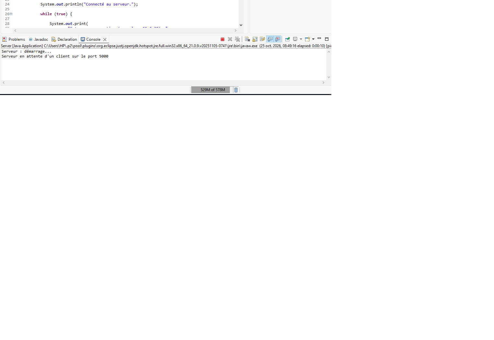
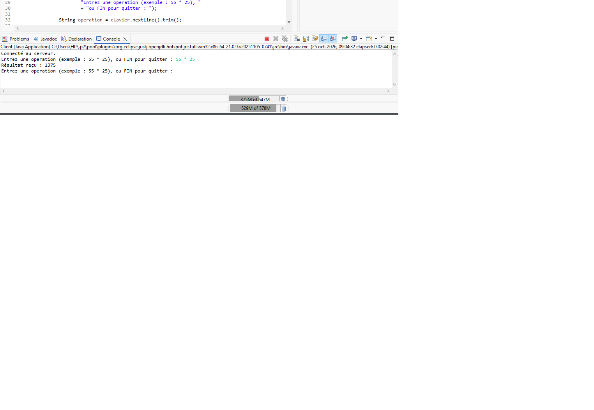
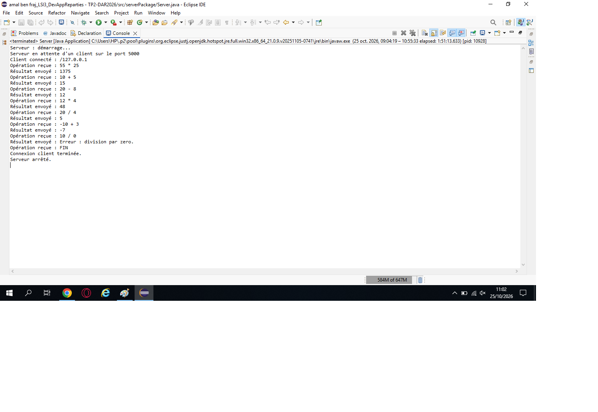
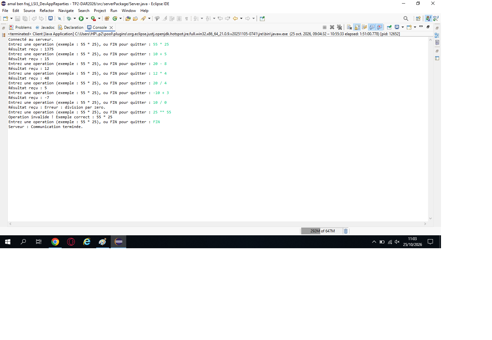
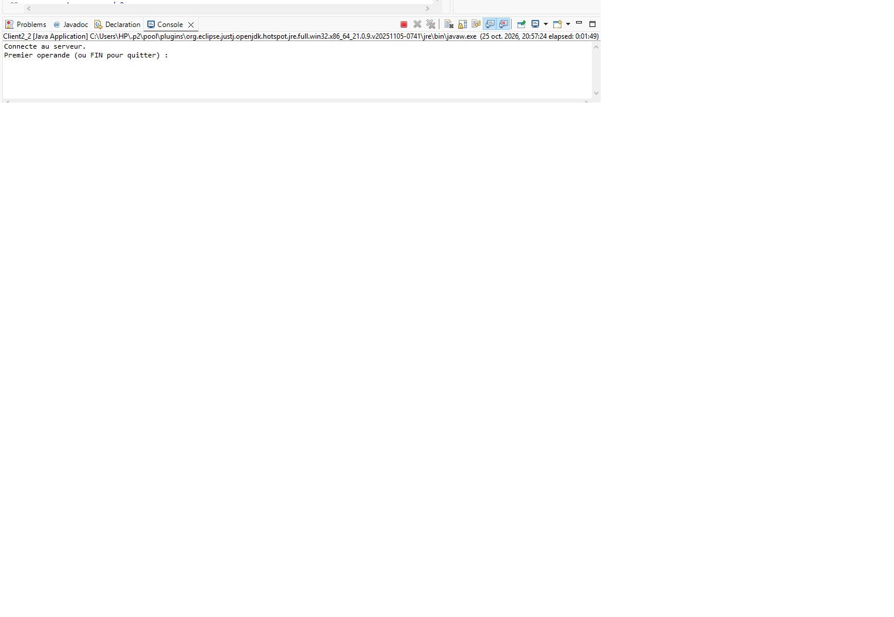
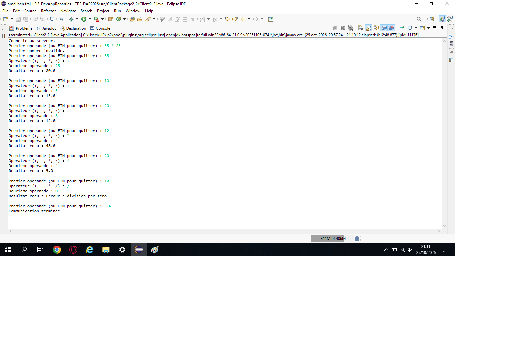
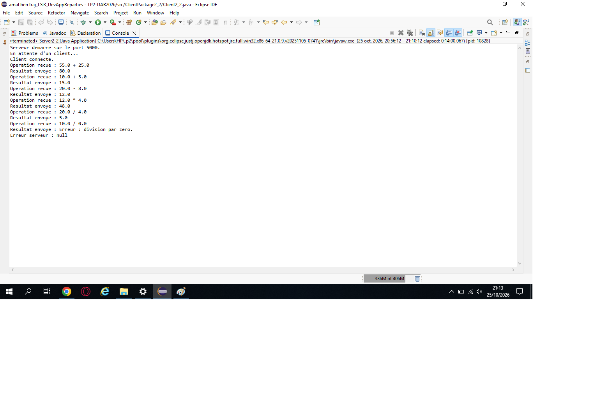

# TP2 — Activité 2-1 : Échange de chaînes de caractères entre Client et Serveur via les sockets TCP

## 1. Objectif

L'objectif de cette activité est de permettre au client et au serveur d'échanger des chaînes de caractères complètes à travers une connexion TCP en Java.

L'application permet au client d'envoyer une opération arithmétique au serveur. Le serveur effectue le calcul et renvoie le résultat au client.

## 2. Environnement de développement

- Langage : Java
- IDE : Eclipse
- Communication : Sockets TCP
- Port utilisé : 5000

## 3. Organisation du projet

- `serverPackage.Server` : établissement de la connexion, réception des opérations, calcul et envoi des résultats.
- `clientPackage.Client` : saisie des opérations, validation de la syntaxe, envoi des requêtes et affichage des réponses.

## 4. Flux de traitement utilisés

- `BufferedReader` : lecture des chaînes de caractères.
- `InputStreamReader` : conversion des octets reçus en caractères.
- `PrintWriter` : envoi des chaînes de caractères.
- `Socket` et `ServerSocket` : communication TCP entre le client et le serveur.
- `Scanner` : lecture des opérations saisies au clavier.

## 5. Fonctionnement

1. Le serveur démarre et attend une connexion.
2. Le client se connecte au serveur.
3. Le client saisit une opération arithmétique.
4. Le client vérifie la syntaxe de l'opération.
5. Le client envoie l'opération au serveur.
6. Le serveur calcule le résultat.
7. Le serveur envoie le résultat au client.
8. Le client affiche le résultat reçu.

Les opérations prises en charge sont l'addition, la soustraction, la multiplication et la division.

Le programme traite également les opérations incorrectes et les divisions par zéro.

## 6. Tests réalisés

| Opération | Résultat attendu |
|---|---:|
| 55 * 25 | 1375 |
| 10 + 5 | 15 |
| 20 - 8 | 12 |
| 12 * 4 | 48 |
| 20 / 4 | 5 |
| -10 + 3 | -7 |
| 10 / 0 | Message d'erreur |

## 7. Captures d'écran
### Démarrage du serveur

### Exécution du client

### Réception et calcul côté serveur

### Tests des opérations

## 8. Conclusion

Cette activité m'a permis de comprendre comment échanger des chaînes de caractères entre un client et un serveur à l'aide des sockets TCP en Java.

J'ai utilisé des flux de traitement de caractères pour envoyer des opérations arithmétiques complètes, réaliser les calculs côté serveur et transmettre les résultats au client.
# TP2 — Activité 2-2 : Échange des objets entre Client/Serveur via les sockets TCP

## 1. Objectif

L'objectif de cette activité est d'implémenter l'échange d'objets entre un client et un serveur Java à travers une connexion TCP.

Cette activité permet d'utiliser l'interface `Serializable` afin de transmettre un objet Java contenant les informations nécessaires à une opération arithmétique.

Le client envoie l'objet au serveur. Le serveur récupère les données de cet objet, effectue le calcul demandé et renvoie le résultat au client.

## 2. Environnement de développement

- Langage : Java
- IDE : Eclipse
- Communication : sockets TCP
- Port utilisé : 5000
- Sérialisation : `Serializable`

## 3. Organisation du projet

Le projet `TP2-DAR2026` est organisé de la manière suivante :

- `commonPackage.Operation` : classe représentant une opération arithmétique et implémentant l'interface `Serializable`.
- `serverPackage2_2.Server2` : serveur qui reçoit l'objet, récupère les données, effectue le calcul et envoie le résultat au client.
- `clientPackage2_2.Client2` : client qui crée et envoie l'objet, puis reçoit et affiche le résultat.
- `captures/` : dossier contenant les captures d'écran de l'activité.

## 4. Classe Operation

La classe `Operation` implémente l'interface `Serializable`, ce qui permet de transmettre ses objets à travers les sockets TCP.

Chaque objet contient trois informations :

- Le premier opérande.
- L'opérateur arithmétique : `+`, `-`, `*` ou `/`.
- Le deuxième opérande.

Par exemple, pour l'opération `55 * 25`, l'objet contient les valeurs `55`, `*` et `25`.

## 5. Fonctionnement de l'application

1. Le serveur démarre et attend la connexion d'un client.
2. Le client se connecte au serveur.
3. Le client saisit les deux opérandes et l'opérateur.
4. Le client crée un objet de la classe `Operation`.
5. Le client transmet cet objet au serveur à l'aide de `ObjectOutputStream`.
6. Le serveur reçoit l'objet avec `ObjectInputStream`.
7. Le serveur récupère les opérandes et l'opérateur.
8. Le serveur effectue le calcul demandé.
9. Le serveur transmet le résultat au client.
10. Le client reçoit et affiche le résultat.

## 6. Flux utilisés

- `Socket` : établit la connexion TCP côté client.
- `ServerSocket` : attend les connexions côté serveur.
- `Serializable` : permet la sérialisation de l'objet.
- `ObjectOutputStream` : permet d'envoyer des objets Java.
- `ObjectInputStream` : permet de recevoir des objets Java.

## 7. Tests réalisés

Les tests suivants permettent de vérifier le fonctionnement de la calculatrice TCP.

| Opération |           Résultat attendu |
| --------- | -------------------------: |
| `55 * 25` |                       1375 |
| `10 + 5`  |                         15 |
| `20 - 8`  |                         12 |
| `12 * 4`  |                         48 |
| `20 / 4`  |                          5 |
| `10 / 0`  | Erreur : division par zéro |

Le client permet également de terminer la communication en saisissant `FIN`.

## 8. Captures d'écran

### 8.1. Démarrage du serveur

### 8.2. Exécution du client

### 8.3. Réception de l'objet et calcul côté serveur

## 9. Conclusion

Cette activité m'a permis de comprendre comment échanger des objets Java entre un client et un serveur à l'aide des sockets TCP.

L'utilisation de l'interface `Serializable`, de `ObjectOutputStream` et de `ObjectInputStream` permet de transmettre un objet contenant les données d'une opération arithmétique. Le serveur traite l'objet reçu et renvoie le résultat au client.

## 10. Dépôt du projet

Le projet Java et le fichier README seront déposés sur GitHub. Le lien du repository sera ensuite soumis sur la plateforme ENT.
